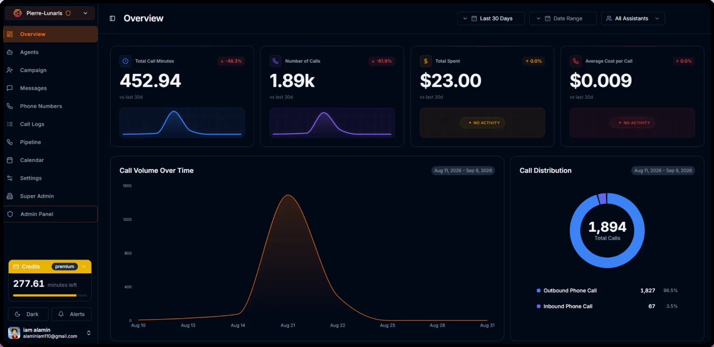

# Fusion Calling — White-Label AI Receptionist & Phone Agent Platform

**Turn missed calls into booked appointments** with AI phone agents that sound and behave like real humans. Fusion Calling answers inbound calls, runs outbound campaigns, books appointments, and qualifies leads 24/7 — and agencies resell the entire platform under their own brand.

[](https://fusioncalling.com)
[](https://fusioncalling.com/whitelabel)
[](https://fusioncalling.com/pricing)
[](https://fusioncalling.com/docs)



---

## 📋 Table of Contents

- [What is Fusion Calling?](#what-is-fusion-calling)
- [Key Features](#key-features)
- [White-Label for Agencies](#white-label-for-agencies)
- [Use Cases](#use-cases)
- [Integrations](#integrations)
- [Getting Started](#getting-started)
- [Documentation](#documentation)
- [Explore](#explore)
- [Tech Stack](#tech-stack)
- [Support & Contact](#support--contact)
- [License](#license)

---

## 🎯 What is Fusion Calling?

**Fusion Calling** is an AI phone platform for businesses and agencies. Our AI voice agents handle calls around the clock without burnout — capturing leads, scheduling appointments, and answering customer questions with human-like conversations. Behind the agents, we run on proven voice infrastructure from **Vapi, Retell, and ElevenLabs**, so call quality and reliability aren't a gamble.

By the numbers:

- **100+** agencies and projects launched on the platform
- **50,000+** calls handled
- **500+** AI agents deployed
- **24 hours** from approval to a branded, live agency platform (applications reviewed within 48 hours)
- **99.9%** uptime SLA

### Core Capabilities

- ✅ **AI Phone Agents** — inbound receptionist and outbound callers, configured without code
- ✅ **Appointment Scheduling** — live calendar integration with booking, reminders, and rescheduling
- ✅ **Lead Qualification** — capture and score leads in real time, route them to your CRM
- ✅ **Multi-Channel** — inbound calls, outbound campaigns, voicemail drop, and SMS
- ✅ **White-Label** — resell under your own brand, domain, and pricing
- ✅ **Try Before You Buy** — 3-day free trial, $0 setup on Starter

---

## ⚡ Key Features

### 🤖 AI Phone Agents

Describe how your agent should behave, what information to collect, and how to handle edge cases — no code required. Agents answer with context, transfer to humans when needed, and log every call.

### 📞 Smart Call Handling

- **Inbound** — answer customer inquiries, route to departments, capture details
- **Outbound campaigns** — run lead generation, surveys, reminders, and collections at scale
- **Voicemail drop** — leave personalized voicemails that get callbacks

### 📅 Automated Scheduling

Agents check live availability, confirm bookings, send reminders, and reschedule on their own. Works with Google Calendar, Outlook, and Cal.com, plus an External Calendar API for anything custom.

### 📊 Lead Management Hub

Real-time lead capture, custom fields and tags, automatic CRM routing, and per-call analytics with recordings and transcripts.

---

## 🏷️ White-Label for Agencies

The fastest way to sell AI receptionist services without building the platform yourself. You get:

- **Your brand, your domain** — full white-label customization, we stay invisible
- **Client management portal** — create and manage unlimited client sub-accounts
- **Your pricing** — charge your own markup; you keep the client relationship
- **Multi-provider agents** — Vapi, Retell, and ElevenLabs behind one dashboard
- **Launch in 24 hours** — guided setup with 30 days of done-with-you support

**Wholesale plans** start at **$99/month** (Starter, 6 sub-accounts), with Growth at $299 (20 sub-accounts) and Scale at $499 (unlimited). Details at [fusioncalling.com/whitelabel](https://fusioncalling.com/whitelabel).

---

## 📱 Use Cases

| Inbound | Outbound |
| --- | --- |
| 24/7 customer support | Lead generation and qualification |
| Appointment confirmation and reminders | Appointment reminders and no-show recovery |
| Lead capture and routing | Follow-up and nurture sequences |
| Emergency / urgent-call triage | Professional, compliant collections |

**Industry solutions** include real estate, healthcare, legal, home services, beauty and wellness, restaurants, veterinary clinics, and more — see [industries](https://fusioncalling.com/industries).

---

## 🔗 Integrations

Connect Fusion Calling with **2,200+ apps and platforms**:

```
CRM & Sales       → HubSpot, Salesforce, Pipedrive, GoHighLevel
Calendars         → Google Calendar, Outlook, Cal.com
Email & Messaging → Gmail, WhatsApp, Slack
AI & Automation   → Zapier, Make, n8n
Custom APIs       → External Calendar API, External Leads API, webhooks
```

---

## 🚀 Getting Started

> This repository contains the **fusioncalling.com marketing site**. The Fusion Calling product itself is self-serve — no setup needed.

### Try the product

1. Start the **3-day free trial** at [app.fusioncalling.com/signup](https://app.fusioncalling.com/signup)
2. Configure your first AI agent (no code)
3. Go live — or [book a demo](https://fusioncalling.com/contact) if you'd rather see it first

### Run the website locally

Prerequisites: Node.js 18+, npm.

```bash
git clone https://github.com/MrAlaminH/FusionCalling.git
cd FusionCalling
npm install
npm run dev
```

Open [http://localhost:3000](http://localhost:3000).

### Build for production

```bash
npm run build
npm start
```

---

## 📚 Documentation

- **[Full Documentation](https://fusioncalling.com/docs)** — complete guides and tutorials
- **[API Reference](https://fusioncalling.com/docs/api-reference)** — External Calendar API & Leads API
- **[Lead Management](https://fusioncalling.com/docs/lead-management)** — master lead handling
- **[Agent Configuration](https://fusioncalling.com/docs/agent-configuration)** — create powerful AI agents
- **[SMS Messaging](https://fusioncalling.com/docs/sms-messaging)** — SMS alongside voice
- **[Admin Guide](https://fusioncalling.com/docs/admin-section)** — manage clients, users, and branding

---

## 🌐 Explore

- [White-Label Program](https://fusioncalling.com/whitelabel) — resell AI receptionists under your brand
- [Pricing](https://fusioncalling.com/pricing) — direct plans and wholesale tiers
- [Blog](https://fusioncalling.com/blog) — guides like [how to start a voice AI agency](https://fusioncalling.com/blog/how-to-start-a-voice-ai-agency)
- [Glossary](https://fusioncalling.com/glossary) — AI voice terminology explained
- [Platform Alternatives](https://fusioncalling.com/alternative) — how we compare to Bland, Retell, Synthflow, and others
- [AI Phone Call Automation](https://fusioncalling.com/ai-phone-call-automation) — pillar guide

---

## 🛠 Tech Stack

This site is built with:

- [Next.js 14](https://nextjs.org) (App Router) — React framework
- [TypeScript](https://www.typescriptlang.org) — strict mode
- [Tailwind CSS](https://tailwindcss.com) — styling
- [Radix UI](https://www.radix-ui.com) — accessible primitives
- [PostHog](https://posthog.com) — product analytics
- [Cal.com embed](https://cal.com) — demo booking
- [lucide-react](https://lucide.dev) — icons
- [react-hook-form](https://react-hook-form.com) + [react-phone-number-input](https://catamphetamine.gitlab.io/react-phone-number-input/) — forms

---

## 📞 Support & Contact

- **Website**: [fusioncalling.com](https://fusioncalling.com)
- **Documentation**: [fusioncalling.com/docs](https://fusioncalling.com/docs)
- **Email**: [hello@fusioncalling.com](mailto:hello@fusioncalling.com)
- **Live chat**: available on our website
- **Book a demo**: [fusioncalling.com/contact](https://fusioncalling.com/contact)

---

## 📄 License

This project is proprietary software owned by Fusion Calling. All rights reserved. For licensing inquiries, contact [hello@fusioncalling.com](mailto:hello@fusioncalling.com).

---

**[Start your 3-day free trial →](https://app.fusioncalling.com/signup)**
